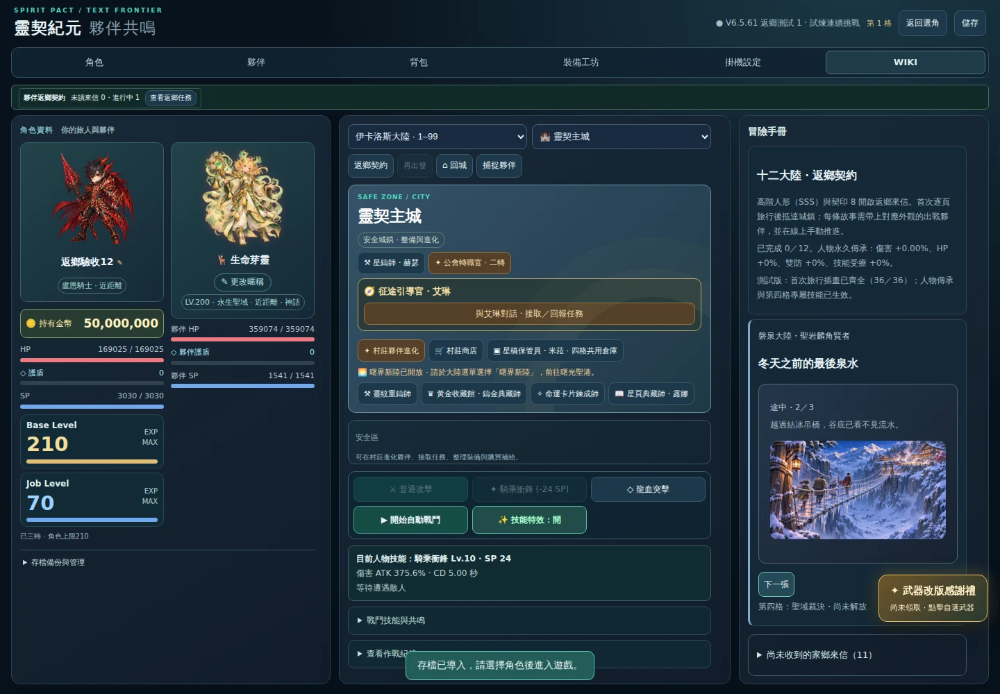
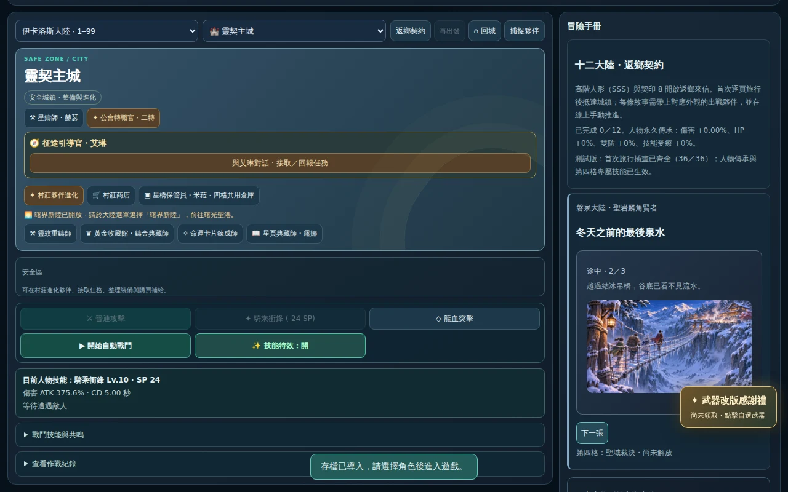
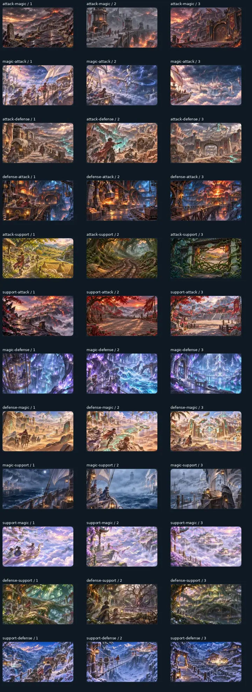

# 返鄉旅程桌面瀏覽器驗收

來源提交：`c2838ce103e58bdf5e29fd9a6ccad798161bbb80`。

[通過的 GitHub Actions](https://github.com/zaza147a/spirit-pact-era/actions/runs/42219342703)；完整截圖位於該次執行的 `homecoming-desktop-browser` artifact（保留 14 天）。本目錄永久保留原始 `report.json` 、兩張代表截圖與整套圖片總覽。

| 檢查 | 結果 |
|---|---|
| 真實瀏覽器 | Chromium 141.0.7390.37，GitHub Actions Ubuntu |
| 桌面尺寸 | 1440×1000、1280×800 |
| 主遊戲旅程 | 12 路線×3 頁×2 種尺寸，共 72 次圖片顯示 |
| 路線互動 | 24 組；實際匯入合法測試存檔、啟程、換頁、抵達、接受委託 |
| 續讀 | 每組第 2 頁重新整理、第 3 頁關分頁重開均維持頁次 |
| 回存與重登 | 匯出確認 active／正確家鄉城鎮，再登入不重播首次旅行 |
| NPC 與任務場景 | 十二城鎮對應 NPC 及各自任務場景正確 |
| 圖片尺寸 | 均解碼為 1280×720，顯示比例 16:9 |
| 水平溢出 | 72 次檢查均無水平超出視窗 |
| 目前路線 | 進行中旅程置頂，未收到的家鄉來信預設收合 |
| 獨立沙盒 | 36 張旅程圖均載入，十二條路線均可抵達並接受委託 |
| 腳本錯誤／失敗請求 | 0／0 |
| 既有回歸測試 | 本地 52／52 通過，遠端 Homecoming flow 成功 |

## 這次修正

- 主遊戲的「4／36 恢復中」與沙盒「36 張待製作」改成目前已齊全的狀態。
- 原本依大陸固定順序顯示所有卡片，後方旅程被未收到的來信推到很下面；改成進行中旅程優先，其次為目前夥伴，其餘未收到來信收合。
- 目視核對代表畫面與 36 張瀏覽器圖片總覽，文字及圖像可辨識，圖片沒有拉伸。

## 驗收範圍與下一步

這是首次旅程、續讀、抵達與接受委託的桌面驗收，不代表八個戰鬥節點的自然戰鬥難度或所有任務結局已在瀏覽器實戰驗收。下一階段應依 `docs/HOMECOMING_FLOW_HANDOFF.md` 與既有 post-Dawn 報告接續自然戰鬥難度檢查，使用合法 210／SSS／契印 8 條件，不以測試強制大傷害代替自然通關。未合併 main、未部署正式版。
