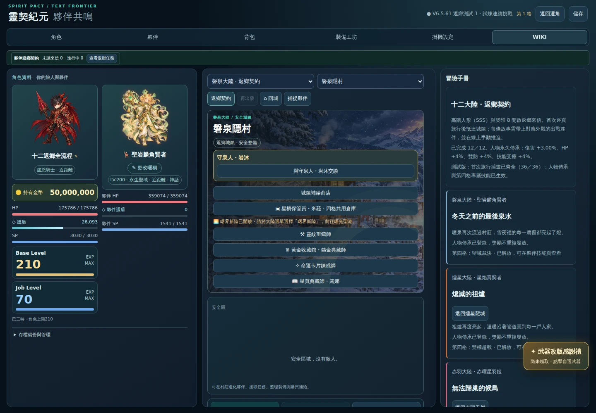

# 十二返鄉故事：完整瀏覽器交付驗收

來源提交：`0768910d63b123c57bd4834f7888ad29bcea191b`。

[成功的 GitHub Actions](https://github.com/zaza147a/spirit-pact-era/actions/runs/42224485489)。本目錄永久保存原始 `report.json`、瀏覽器實際匯出的 `complete-save.json` 與完成截圖；完整逐條截圖也在 `homecoming-twelve-complete-stories` artifact（保留 14 天）。

## 完成結果

**12／12 條正規故事完成交付**。使用同一角色依序切換十二種有序融合夥伴，實際收信、逐頁旅行、接受任務、按事件選項、正常戰鬥、回城交付，沒有注入任務進度或呼叫強制勝利。

| 家鄉 | 故事 | 事件選擇次數 | 自然戰鬥場數 | 第四格技能 | 本條開始前 |
|---|---|---:|---:|---|---|
|燼星龍城|熄滅的祖爐|5|1|雙極超載|本次首度解放|
|赤羽天都|無法歸巢的候鳥|4|0|雙極超載|已由反向解放|
|玄關壁城|最後一道關門|3|1|裂陣戰旗|本次首度解放|
|赤砧爐堡|不再回響的鐵鎚|5|0|裂陣戰旗|已由反向解放|
|玉穗原鄉|被切斷的豐收路|6|0|逐獵接力|本次首度解放|
|丹旌武鄉|遲到的歸旗人|5|1|逐獵接力|已由反向解放|
|晶歌深城|逐漸失聲的城市|4|1|星壁蓄砲|本次首度解放|
|環符祕城|結界之內的陌生人|6|0|星壁蓄砲|已由反向解放|
|白羽聖港|沒有黎明的燈塔|6|0|靈脈共奏|本次首度解放|
|雲織仙鄉|落向大地的故鄉|7|0|靈脈共奏|已由反向解放|
|翠庭樹城|世界樹的空心處|5|1|聖域裁決|本次首度解放|
|磐泉隱村|冬天之前的最後泉水|5|0|聖域裁決|已由反向解放|

## 已驗證的結果

- 十二條各自抵達不同結局；每條交付後都沒有再次領取按鈕，匯出／重新登入後仍為 claimed，累積完成數只增加一次。
- 傳承逐條累積，最後傷害 **+3%**、HP **+4%**、雙防 **+4%**、技能受療 **+4%**。畫面與實際匯出存檔一致；完成畫面的人物最大 HP 為 175,786。
- 六種專屬第四技能全部解放，實際夥伴技能頁顯示「已解放」。完成一個方向後，反向夥伴的第四技能共享解鎖，但反向故事仍從自己的來信開始，不會被代為完成。
- 十二條各自交付、匯出、重登均保留進度與傳承，故事地圖離線收益持續關閉。
- 五場正規路徑戰鬥均使用正常瀏覽器時鐘、正常自動技能及補給。正規路徑未經過的可選伏擊／斷後／巡兵節點，已在另外的八節點自然瀏覽器報告驗證，沒有為湊數重跑。
- 腳本錯誤、失敗請求均為 0。沒有改動遊戲數值或傷害公式。

## 條件與重現

Chromium 141.0.7390.37，1440×1000。全新盧恩騎士 210 等、200 神話 SSS／最高合法詞條與首領卡、契印 8，攜帶十二種合法 SSS 融合夥伴，只出戰當前一隻。基本配點合計 438、單項不超過 150；人物與所有夥伴減傷不超過 40%。

同一角色連續完成，所以後段戰鬥會包含前面已正常獲得的傳承與正反向共享解鎖。這份戰鬥秒數不應與「首次返鄉前、零傳承」的獨立八節點樣本直接當成同條件 DPS 排名。

`complete-save.json` 是由實際完成的頁面匯出，不是手填 claimed。另已重新以遊戲 normalize／valid 檢查：12 個完成路線、12 隻夥伴全部可解鎖第四格，配點 438、減傷合法。此檔供測試版獨立角色格重現。

```bash
node scripts/browser/homecoming-full-story.mjs
```

本機的瀏覽器 socket 受限制時，使用測試分支的 `Homecoming twelve complete browser stories` 工作。它只在自身腳本／工作改動或手動觸發時執行，不隨每次一般更新重跑。



## 範圍與後續

本報告驗證十二條正規結局、交付、傳承與第四技能解鎖，不代表所有錯誤選項／可選分支都做過瀏覽器負向測試，也不等於六種第四技能的瀏覽器充能／SP／冷卻實戰或全職最佳融合配裝排名。這些邊界與不同投資程度的難度比較應分開安排，避免重跑既有大矩陣。

下一步可先做整合審核，對照最新 main 的變更與本分支差異，列出合併相容性與仍待驗證項目。本次僅提交 `feature/companion-homecoming`，未合併 main、未部署正式版。
