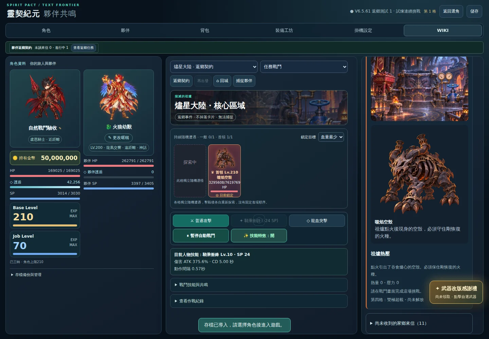
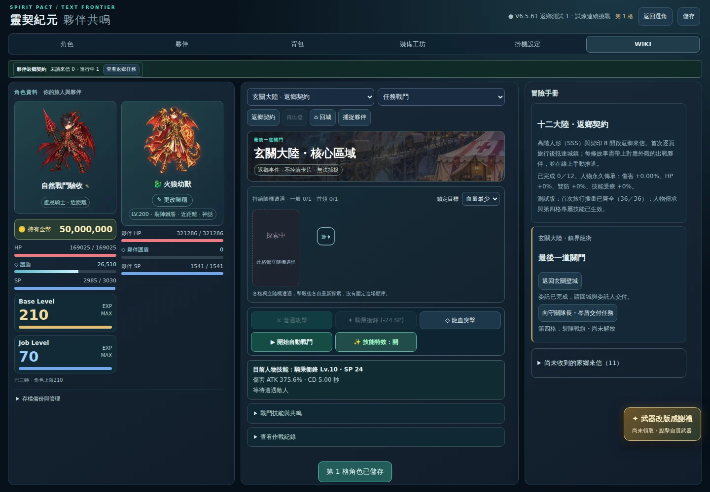
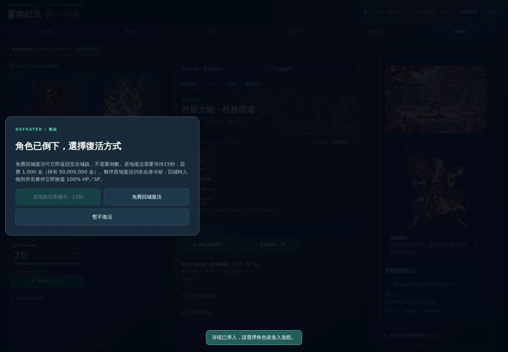

# 八節點自然戰鬥：實際桌面瀏覽器驗收

來源提交：`dbf83efddcc3cf266f3ba5215a3b1637698700dd`。

[成功的 GitHub Actions](https://github.com/zaza147a/spirit-pact-era/actions/runs/42222421359)；完整截圖在 `homecoming-natural-browser-combat` artifact（保留 14 天）。本目錄永久保留原始報告與代表截圖。

## 結果

八個戰鬥節點 **8／8 自然通關**，兩個卸裝戰敗控制 **2／2 通過**，沒有腳本錯誤或失敗請求。敵人數值、傷害公式與正式版維持既有設定。

| 節點 | 敵人 | 實際戰報秒數 | 藥水總消耗 | 夥伴倒下次數 |
|---|---|---:|---:|---:|
|祖爐首領|噬焰空殼|43.433|11|0|
|護送伏擊|裂隙斥候|4.803|0|0|
|護送斷後|裂隙斥候|5.565|0|0|
|最後守關|裂隙攻城獸|53.244|16|0|
|空鎧巡邏|空鎧巡兵|7.464|0|0|
|師父演武|守旗師父|8.952|0|0|
|晶核首領|噤聲晶核|36.844|5|0|
|幼苗守衛|噬脈寄生靈|8.125|0|0|

- 八場均由普通攻擊、自動技能、共鳴與正常補給完成；有自然傷害戰報，沒有直接殺敵或呼叫勝利。
- 每場勝利均推進正確任務節點；師父演武的戰報為「演武通過」。
- 沒有額外經驗、Job 經驗、金幣、卡片、一般擊殺計數或故事掉落。首次通關前第四技能仍未解鎖。
- 每場均匯出並重新登入，任務進度保留，故事地圖的離線收益維持關閉。
- 祖爐與演武的卸裝戰敗控制均能免費回到對應家鄉、恢復滿 HP、保留未完成節點，匯出再登入仍正確。這兩場刻意不攻擊與不補給，只驗證敗退流程，不列入難度樣本。

## 合法條件與方法

實際 Chromium 141.0.7390.37／1440×1000。使用既有 `homecomingPlayer` 的盧恩騎士：210 等、200 神話 SSS 裝、最高合法詞條與按職業評分的首領卡、契印 8、對應路線的 SSS 人形融合夥伴。基本配點總額 438、單項上限 150；人物與夥伴減傷均不超過 40%。首次返鄉前不給第四技能或人物傳承。

這套配裝已有先前 `homecoming-post-dawn` 的同配裝曙光混戰合格對照。本輪補的是實際瀏覽器戰鬥與回存，不重跑那份舊十職 160 場 VM 初驗。

測試匯入合法的指定節點存檔，從家鄉按「前往」與「自動戰鬥」開始，使用正常瀏覽器時鐘與原本戰鬥迴圈，不加速時間、不修改敵人 HP、不注入傷害。VM 僅用來準備合法滿 HP／SP 與檢查配裝，不執行這八場戰鬥。原始報告保留逐場人物／夥伴傷害、承傷、防禦與補給資料。

最低人物 HP 以 250 ms 讀取畫面觀測，這組配置八場均為 100%，戰報也記錄人物直接承傷為 0。壓力主要由防禦、護盾與夥伴承受；三隻首領對夥伴的實際累計傷害分別為 336,831／948,270／232,849，補給照常消耗。不能只看人物滿血便推論整場沒有壓力，也不能把最高詞條配置推廣成所有 SSS 配裝的通關保證。

## 代表畫面

## 範圍與下一步

本輪是單一職業、每個節點一個原生亂數樣本，補齊八節點的實際瀏覽器戰鬥／回存證據；不是全職最大 DPS 排名、不同投資程度的最終平衡結論，也不是十二條敘事從頭到交付的完整瀏覽器通關。下一階段應接十二條任務的完整對話選擇、回城交付、獎勵與第四技能解鎖；再依需要做多種子與不同投資程度比較。全部保持測試分支，不合併 main、不部署正式版。
