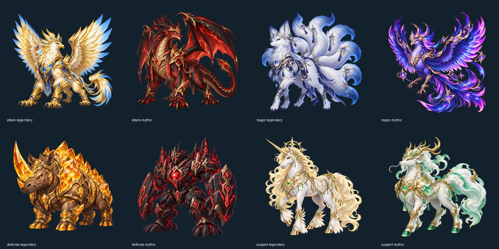

# V5.0.0 蒼穹機界

本版由 GitHub Pages 發布，沿用四角色存檔。舊存檔首次載入會調整裝備能力、卡片綁定與轉生技能；建議先於角色選單匯出存檔備份。

## 地區與成長

轉生角色上限150；轉生前仍99。轉生角色擊殺1–99地區怪物不受等差經驗懲罰，1–99升級經驗需求仍為原本兩倍。101以上恢復等差20起降、超過40歸零；未開放100級獨立地圖。轉生100級後基本屬性上限120，此前99。

| 新地區 | 等級 |
|---|---|
| 浮空港灣 | 101–110 |
| 千輪機關城 | 111–120 |
| 以太晶海 | 121–130 |
| 雷霆熔爐 | 131–140 |
| 天極斷界 | 141–150 |

新地區回城到蒼穹樞城，目前提供商店與寵物進化。原村莊維持原任務功能。新區域各有怪物、獨立首領、卡片與專屬雜物。101以上首領1%掉落「天極突破聖證」，作為未來三轉預備材料，不列入自動販賣。三轉本身尚未開放。

裝備八階：晨曦1–20、征途21–35、星輝36–50、天啟51–70、聖域71–90、創世91–110、蒼穹111–130、永恆131–150。同用途下一階普通核心數值高於上一階神話；神話才有特殊詞。1–50維持入門強度，51–99正常難度；新區採前階傳說裝備、80%配點配置作獨立校準。

## 屬性與技能

可分配點數為等級成長加轉生20點。裝備六項屬性總和上限為該裝備階段終點可分配點數的30%，卡片六項屬性全身合計上限24；超過按比例縮放。這限制的是六項基本能力，不是裝備ATK或HP白字。

STR近距離物理、DEX遠距離物理、INT魔法各提供每點0.8%額外傷害乘區；AGI每點0.45%迴避、VIT每點0.6%雙防、LUK每點增加0.5個百分點暴擊傷害。裝備與Job加成仍顯示在基本值後的加值中。人物能力可輸入一次分配數量，避免逐點操作與數字換行。

巫師變動詠唱公式為原詠唱乘上「1−sqrt((INT+2DEX)/門檻)」，最低零；門檻一般450、轉生100以上540，計入Job、裝備與卡片。120基本值與合法加值可達無詠唱。大型轉生主攻保留0.9秒動作間隔下限，CD仍0，介面顯示此限制。

轉生二轉Job上限70。Job51–70新增20專用技能點，分別投入新主攻與永久被動BUFF（各10級）。學習新主攻後替代舊主攻；沒有學習時保留舊主攻。取消舊版自動贈送的1級轉生技能，轉為實際學習點數。重置會退回對應點數池。技能及共鳴名稱、條件與數字同步更新；指定需要開場護盾或治療的共鳴會顯示優先順序建議，不擅自改寫玩家設定。

## 寵物界限進化

傳說／神話、99級、完成原本五階進化的寵物，可回城以超越靈核30與「蒼穹界限靈髓」10進行界限進化。進化本身必定成功，傳說另有5%變成神話。已界限進化的傳說，可另花超越靈核50與靈髓20進行異化，15%變為神話，失敗保留原寵物。確認視窗顯示材料與機率，進化播放動畫並換用新立繪。

| 類型 | 傳說界限形態 | 神話界限形態 |
|---|---|---|
| 攻擊 | 蒼穹曜翼獅鷲 | 赤曜裂界龍皇 |
| 魔法 | 霜月九尾靈狐 | 星焰輪迴神凰 |
| 防禦 | 琥珀山脈晶犀 | 終界玄岩泰坦 |
| 輔助 | 聖光星冠獨角獸 | 太初玉麟聖君 |

靈髓由101以上一般怪物8%掉落、首領必掉。界限寵物最高150級；為保留其他稀有度玩法，轉生主人的未界限寵物也能升至150。忠誠度由存活出戰寵物參與擊殺且與怪物等差不超過40時增加1，上限10000。目前記錄忠誠度，尚未開放額外忠誠事件。

## 卡片與操作

卡片按部位重製：防具偏防禦，頭上中下提供能力值，武器／副手／飾品提供攻擊類效果；區域保有不同搭配方向，白字隨角色當前裝備階段成長。全172張卡片沒有完全相同的能力組合，但可共享部分能力。詳見[完整卡片表](cards-v50.md)。已鑲嵌位置、能力及卸下操作顯示在裝備列；卡片固定於身體部位，換裝不帶走，舊存檔不合法綁定退回卡片背包。

一般桌面左側與中間縮至視窗內，右側保留滾動；小螢幕與展開額外資訊仍可滾動。精簡任務提示，移除地圖長說明及難度標籤。戰鬥更新不重建正在編輯的欄位，使用者主動更換設定則立即更新相關選項。

背包細分雜物、任務／突破／轉生材料、裝備碎片等；未穿戴物品與卡片可指定數量手動販賣，重要材料需要確認。融合顯示機率、可達屬性範圍與目標數值輸入。戰鬥紀錄增加近60秒每分鐘擊殺數與主人／寵物來源分開DPS，含輔助增傷歸屬，避免重複計算。

## 平衡驗證範圍

見[平衡說明](balance-v50.md)及[原始報告](balance-v50.json)。40種職業與寵物組合以罕見裝備、罕見寵物，在99與150級分別驗證無卡及合法部位卡片配置。清怪差距使用最快／最慢減一，不以承傷或治療冒充清怪速度。這是宣告配置與區域的驗證，不能推論所有自訂配點、每張地圖或首領都同樣小於30%。
